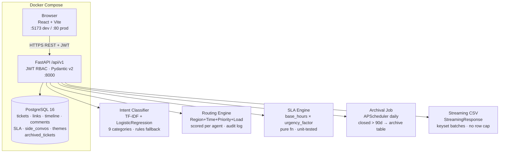

# OpsDesk — TBO Operations Ticketing MVP

> **"OpsDesk replaces isolated tickets with context-rich, travel-aware operations cases — linked by agency and TBOH, routed by reality, escalated on purpose."**

## Quick Start

```bash
# 1. Copy env (secrets already have safe defaults for local dev)
copy .env.example .env

# 2. Start everything — auto-migrates + auto-seeds
docker compose up --build

# Frontend:  http://localhost
# API:       http://localhost:8000/api/v1
# API Docs:  http://localhost:8000/docs
```

> First boot takes ~60s while Docker pulls images and runs Alembic migrations + idempotent seed.

---

## Demo Accounts

| Email | Password | Role | Region / Agency |
|---|---|---|---|
| `agent1@tbo.com` | `Demo@1234` | Agent | IN-West · demo shift 00:00–23:59 |
| `agent2@tbo.com` | `Demo@1234` | Agent | IN-East · demo shift 00:00–23:59 |
| `em@tbo.com` | `Demo@1234` | Escalation Manager | IN-West |
| `lead@tbo.com` | `Demo@1234` | Lead | Full access |
| `agency_a@horizons.com` | `Demo@1234` | Requester | Horizons Travel (IN-West) |
| `agency_b@sunrise.com` | `Demo@1234` | Requester | Sunrise Tours (IN-East) |
| `agency_c@peak.com` | `Demo@1234` | Requester | Peak Adventures (ME) |

---

## Demo Journeys (A–E)

### Journey A — Context & Linkage (Problem 1)
1. Log in as `agent1@tbo.com`
2. Open ticket for TBOH `TBO12345` → Case 360 panel shows **2 prior tickets** on the same TBOH
3. Notice the banner: **"3rd contact about refund from Horizons Travel"**
4. See intent auto-classified as `refund` with confidence score

### Journey B — Routing (Problem 2)
1. Log in as `lead@tbo.com` → open the **Triage** queue
2. Create a new P1 ticket for region IN-West
3. Ticket auto-assigns to **agent1** (IN-West match, P1 priority, online, lowest load)
4. Open ticket detail → see the stored score breakdown: region match, local shift, availability, priority weight and open workload

### Journey C — Side Conversation (Problem 3)
1. Log in as `agent2@tbo.com`
2. Open ticket `TBO77777` (Peak Adventures, supplier issue)
3. See the **active supplier side conversation** with explicit recipients: `supplier@hotelpeak.com`, `agent2@tbo.com`
4. Reassign the ticket to `agent1`
5. Observe timeline event **"Side conversation recipients preserved after transfer"** — recipients unchanged

### Journey D — SLA & Escalation (Problem 4)
1. Log in as `em@tbo.com` → **Escalation Queue** shows 1–2 items
2. Log in as `agent1@tbo.com` → open ticket `TBO12345` (check-in tomorrow, P2)
3. See SLA chip showing **"⚠ At Risk"** (check-in proximity shrinks the SLA window to 2h)
4. Click **"Escalate to Escalation Manager"** → select `em@tbo.com` → confirm
5. Status → `Escalated`, ticket appears in EM's queue, timeline shows escalation event

### Journey E — Insights & Export (Problems 5 & 6)
1. Log in as `lead@tbo.com`
2. Navigate to **Insights** → see top themes (`refund_delay`, `supplier_delay`, etc.) with counts and sample tickets
3. Navigate to **Export** → click Export CSV
4. Download streams with real-time row count — **no 3K cap**
5. For 50K row demo: set `SEED_BULK=true` in `.env` and run `docker compose up --build`; the entrypoint inserts only the missing bulk rows and will not duplicate them on restart.

---

## Feature Checklist (Problems 1–6)

### MVP-1 ✅ Context-rich Tickets (Problem 1)
- [x] Ticket fields: title, description, agency, TBOH, priority (P1–P4), intent, check_in_date, lcd, status, assignee, region, sla_due
- [x] Status flow enforced server-side: `New → Open → Pending → Escalated → Resolved → Closed`
- [x] First-class ticket linkage: **strong** (same TBOH), **medium** (agency+intent ≤30d), **weak** (agency ≤7d)
- [x] Case 360 panel: linked tickets with reasons, scores, contact count banner
- [x] Intent taxonomy: 9 categories, manual select + auto-suggest (TF-IDF + LR, top-3 with confidence)
- [x] Activity timeline: status changes, assignment, links, escalations, notes, SLA events
- [x] Durable ticket-level comments: public requester comments and private staff notes, stored separately from side-conversation messages

### MVP-2 ✅ Routing & Ownership (Problem 2)
- [x] Assign / reassign / unassign with full audit trail
- [x] Routing engine scores every available agent: region match (+40), priority (+30/20/10/5), shift window (+20), availability (+15), open load (up to +25)
- [x] Human-readable routing reason stored and shown in UI: "Routed because: ..."
- [x] Views: Triage, My Queue, By Region, By Intent, Linked Cases, Escalation Queue

### MVP-3 ✅ Side Conversations (Problem 3)
- [x] Explicit recipient list independent of ticket group
- [x] Recipients preserved after ticket transfer / reassignment (timeline event + tested)
- [x] Internal notes vs external replies distinguished in model and UI

### MVP-4 ✅ Travel-aware SLA & Escalation (Problem 4)
- [x] SLA due = `base_hours[priority] × urgency_factor(check_in, lcd)` — pure function, unit-tested
- [x] At-risk (< 25% of window remaining or < 1h) and breached indicators on queue and ticket detail
- [x] First-class **Escalate to Escalation Manager** action: changes owner, sets status `Escalated`, creates timeline event

### MVP-5 ✅ Feedback / Insight Loop (Problem 5)
- [x] Theme tagging: `refund_delay`, `inventory_sync`, `supplier_delay`, `payment_failure`, `special_request`
- [x] Insights page: top themes with counts and 5 sample tickets each
- [x] Theme tagging re-evaluates ticket text, public comments and external side-conversation messages; internal notes are excluded
- [x] Optional suggested product/bug link field on the ticket

### MVP-6 ✅ Data Access (Problem 6)
- [x] PostgreSQL 16 with Docker named volume — tickets, links, comments and side conversations persist across `docker compose restart`
- [x] Streaming CSV export (`StreamingResponse` + keyset pagination) — no artificial row cap, `X-Row-Count` header
- [x] Archival job: closed tickets older than 90 days → `archived_tickets` table (APScheduler, runs daily)
- [x] Bulk generator: `SEED_BULK=true` inserts 50K tickets in batches

### MVP-7 ✅ Roles & Access (RBAC)
- [x] Requester: own agency tickets only — cross-agency attempts return 403/404 (IDOR-tested in `test_rbac.py`)
- [x] Agent: all org tickets, ticket comments, side conversations, assignment
- [x] Escalation Manager: only their assigned escalation tickets + escalation actions
- [x] Lead: all agent rights + Insights + Export

---

## PS Traceability & Explicit MVP Scope

| OpsDesk PS requirement | Implementation / scope |
|---|---|
| MVP-1: ticket fields, first-class linkage, intent manual + auto-suggest, status flow, activity timeline | Implemented; TF-IDF + Logistic Regression with documented fallback; ticket-level comments are durable records. |
| MVP-2: assign/reassign/unassign, at least two routing dimensions, queue views, routing reason | Implemented; region, region-local shift window, priority, availability and workload ranking; no eligible agent means Triage. |
| MVP-3: explicit side-conversation recipients, transfer-safe recipients, internal/external distinction | Implemented; staff-managed side threads; requester-facing discussion uses public ticket comments. |
| MVP-4: priority + check-in/LCD SLA, at-risk/breached indicators, direct EM escalation | Implemented. Regional holiday calendars and cross-team dependency calendars are not part of this MVP. |
| MVP-5: theme tags, weekly insights and sample tickets | Implemented with lightweight rule-assisted theme tagging; suggested product/bug link field is available. |
| MVP-6: durable persistence, uncapped export/API, retention and scale stance | Implemented with PostgreSQL volume, keyset-streamed CSV export, 90-day closed-ticket archival with case-history snapshots, and documented scale path. |
| MVP-7: requester/agent/EM/lead roles and agency isolation | Implemented with API-level role checks and requester-safe ticket, link, comment and timeline responses. |
| Technical expectations: working demo, setup README, durable comments/side conversations, empty/loading/error states, validation and least privilege | Implemented in source; run the clean Docker build and test commands before judging/submission. |

**Stretch scope not claimed as complete:** WebSocket/CDC push (the MVP uses 15-second polling), supplier portal UX, outbound email delivery, webhooks, CSAT and macros. The PS marks these as nice-to-have, not must-have. Multi-tenancy, production SSO and full omnichannel are out of scope.

## Architecture



### Cost vs "Pay-per-add-on / TPS API Glue"

| Dimension | Zendesk + TPS APIs | OpsDesk |
|---|---|---|
| Ticket linkage | 3rd-party app \$\$\$ | First-class, \$0 extra |
| Intent routing | Manual rules or AI add-on | TF-IDF+LR trained at startup, in-process |
| Side convo recipients | Stuck to group | Explicit, transfer-safe |
| SLA urgency | Config-heavy, incomplete | Pure function, 1 file, unit-tested |
| Export | 3K cap, API tax | Keyset-streamed CSV, no artificial row cap |
| Escalation | Email triggers / followers | First-class action + dedicated queue |
| Run cost | Per-seat + per-API call | Single `docker compose up` |

---

## API Endpoints (/api/v1)

| Method | Path | Roles | Description |
|---|---|---|---|
| POST | `/auth/login` | Public | Returns JWT + user info |
| GET | `/me` | Any auth | Current user info |
| GET | `/users?role=agent` | Agent/Lead/EM | Staff directory for assignment and escalation pickers |
| GET | `/tickets` | Any* | Paginated list; supports status, priority, intent, region, TBOH, assignee, unassigned and linked-case filters |
| POST | `/tickets` | Requester/Agent/Lead | Create ticket (auto-links, auto-routes; stays in Triage if no eligible agent) |
| GET | `/tickets/{id}` | Any* | Ticket detail + Case 360 (SLA recomputed) |
| PATCH | `/tickets/{id}` | Requester/Agent/Lead/EM | Requesters may edit customer-facing title/description only; staff may update operational fields |
| POST | `/tickets/{id}/transition` | Agent/Lead/EM | Status transition |
| POST | `/tickets/{id}/assign` | Agent/Lead/EM | Assign / reassign |
| POST | `/tickets/{id}/unassign` | Agent/Lead/EM | Return ticket to Triage with audit event |
| GET | `/tickets/{id}/comments` | Any* | Requester sees public comments; staff see public and internal comments |
| POST | `/tickets/{id}/comments` | Any* | Requester creates public comments; staff can create internal/public comments |
| GET | `/tickets/{id}/links` | Any* | Linked tickets sorted by score |
| GET | `/tickets/{id}/timeline` | Any* | Staff full timeline; requester-safe status/public-comment events |
| POST | `/tickets/{id}/escalate` | Agent/Lead/EM | First-class escalate to EM |
| GET | `/tickets/{id}/side-conversations` | Agent/Lead/EM | Side convos + recipients + messages |
| POST | `/tickets/{id}/side-conversations` | Agent/Lead/EM | Create side convo (explicit recipients) |
| POST | `/side-conversations/{id}/messages` | Agent/Lead/EM | Add internal/external message |
| POST | `/routing/auto-route/{ticket_id}` | Agent/Lead/EM | Manual re-route |
| GET | `/insights/themes` | Lead | Theme counts + sample tickets |
| POST | `/intent/suggest` | Any auth | Intent auto-suggest (top-3) |
| GET | `/export/tickets` | Lead | Streaming CSV, all filters, no cap |
| GET | `/health` (root) | Public | Health check; this endpoint is outside the `/api/v1` prefix |

*Requesters see only their own agency's data. Side conversations are staff-managed; requesters communicate through public ticket comments. Queue freshness uses 15-second polling (near-real-time for the MVP, not a websocket push channel).

---

## Scaling Notes

For production scale (50K+ live tickets, real-time dashboards):

| Concern | Approach |
|---|---|
| **Read throughput** | Add PostgreSQL read replica; point insights/export queries there |
| **Near-real-time sync (MVP)** | 15-second React Query polling for queue freshness |
| **Production real-time sync** | CDC via pg_logical / Debezium → Kafka → websocket push |
| **Large exports** | Background job + S3 presigned URL; keyset streaming should be benchmarked on the target environment before quoting throughput |
| **Partitioning** | Partition `tickets` by `created_at` month; `archived_tickets` auto-managed |
| **Index coverage** | All hot paths indexed: tboh, agency_id, intent, status, assignee_id, sla_due, region |
| **Model at scale** | Intent classifier trained once at startup; for retraining, persist training data to DB and retrain on schedule |

---

## Run Steps & Commands

```bash
# Prerequisites: Docker Desktop

# Start
docker compose up --build

# Restart without rebuild (data persists)
docker compose up

# Stop (data preserved in Docker volume)
docker compose down

# Wipe everything including DB
docker compose down -v

# 50K bulk ticket demo
SEED_BULK=true docker compose up --build

# Backend tests (requires Python 3.11 locally)
cd backend
pip install -r requirements.txt
python -m pytest tests/ -v
# 34 test functions in the suite (run in a Python 3.11 environment)

# Frontend build check
cd frontend
npm install
npm run build
# Expected: TypeScript and Vite build complete with 0 errors
```

---

## Data Model Summary

```
agencies          → id, name, region
users             → id, email, role, region, agency_id, shift_start/end, availability, current_load
tickets           → id, title, tboh, agency_id, priority, intent, status, assignee_id, region,
                    check_in_date, lcd, sla_due, sla_status, routing_reason, contact_count
ticket_links      → source_id, target_id, link_type, reason, score
timeline_events   → ticket_id, actor, event_type, payload, created_at
ticket_comments   → ticket_id, author, body, visibility (internal|public), created_at
routing_log       → ticket_id, chosen_agent_id, candidate_scores (JSON), reason_text
side_conversations → ticket_id, subject, kind (supplier|agency)
side_recipients   → side_conversation_id, email, name  ← explicit, not bound to group
side_messages     → side_conversation_id, body, kind (internal|external)
themes            → id, name
ticket_themes     → ticket_id, theme_id, confidence
escalations       → ticket_id, escalated_by_id, escalated_to_id, reason
archived_tickets  → ticket mirror + archived_at, archive_reason + timeline/link/side-convo/routing/theme/comment/escalation snapshots
```

---

## Assumptions

| Item | Decision |
|---|---|
| Auth | Demo JWT (seeded users, bcrypt hashed). No real IdP / SSO. |
| Agent availability | Simulated via `availability` bool + `shift_start/shift_end` on User. Demo agents use 00:00–23:59 for deterministic demos; change these values to test off-shift routing. No calendar integration. |
| Regional calendars | Optional public-holiday calendar is not implemented; seeded region and local shift fields drive time-window routing. |
| Intent model | TF-IDF + LogisticRegression trained on ~80 embedded examples at startup. Falls back to keyword rules if model confidence < 0.4. |
| Multi-tenancy | Single TBO org for the hackathon. Multi-tenant = optional stretch. |
| Email delivery | Side conversation recipients stored; no actual email sent in demo. |
| AI costs | No external LLM calls or per-request model-provider fees. The in-process scikit-learn classifier still consumes host CPU/runtime resources. |

---

## Security Baseline

- Passwords hashed with bcrypt
- JWT HS256, 8h expiry, secret from `.env`
- CORS locked to `CORS_ORIGINS` env var (frontend origin only)
- Cross-agency ticket access and linked-ticket details are restricted at API layer; verify with `test_rbac.py`
- Insights and CSV export are Lead-only; internal notes are staff-only
- Requesters can only add public comments and cannot change operational priority/SLA fields
- All DB queries via SQLAlchemy ORM — no raw SQL injection risk
- No hardcoded secrets — all via `.env`
- Rate limiting on `/auth/login`

---

## AI Tools

Built with **Antigravity (Google DeepMind)** AI coding assistant for scaffolding and code generation, with human review and manual fixes for all integration issues.

---

*OpsDesk · TBO Hackathon 2026 · Phase 8 complete*
